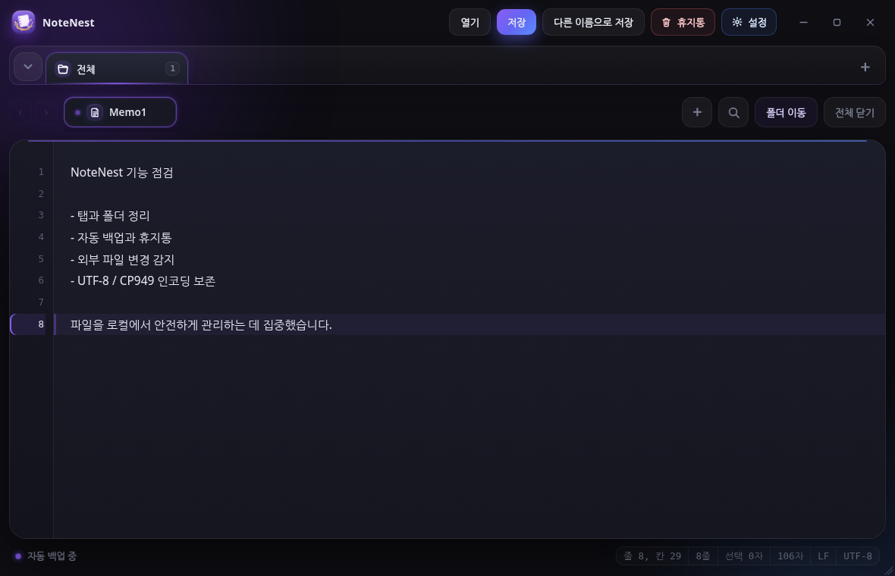

# NoteNest

계정이나 외부 서버 없이 PC에서 텍스트 파일을 관리하는 Windows 메모 앱입니다. Python의 파일 처리 기능과 pywebview 기반 화면을 결합해 탭, 폴더, 자동 백업, 휴지통, 인코딩 보존을 한 화면에서 다룰 수 있게 만들었습니다.



위 이미지는 현재 HTML과 CSS 구조를 브라우저에서 렌더링한 UI 미리보기입니다. GitHub 공개 전 Windows에서 실행한 실제 화면으로 교체하면 더 좋습니다.

## 주요 기능

- **🔐 암호화 금고 (Vault)** — 폴더를 마스터 비밀번호로 잠그고, 안의 메모를 AES-256-GCM으로 로컬 암호화
- 여러 메모를 탭으로 열고 순서를 드래그해 변경
- 폴더 탭, 메모 검색, 폴더 일괄 이동
- 자동 백업과 앱 내부 휴지통 복구
- 찾기, 바꾸기, 실행 취소, 다시 실행
- UTF-8, UTF-8-BOM, CP949, UTF-16 인코딩 처리
- LF, CRLF 줄끝 형식 보존
- 외부 파일 변경과 삭제 감지, 저장 충돌 확인
- 읽기 전용 파일 안내와 다른 이름으로 저장
- 다크 및 화이트 테마, 글꼴과 백업 주기 설정
- PyInstaller를 이용한 Windows 단일 EXE 빌드

## 실행 방법

```powershell
python -m venv .venv
.\.venv\Scripts\Activate.ps1
python -m pip install -r requirements.txt
python memo.py
```

## 테스트

설치 없이 바로 실행 (표준 라이브러리 `unittest` 사용):

```powershell
python -m pip install cryptography
python -m unittest discover -s tests -p "test_*.py" -v
```

또는 pytest를 선호하면(선택, `unittest.TestCase` 기반이라 그대로 인식됩니다):

```powershell
python -m pip install -r requirements-dev.txt
python -m pytest -q
```

현재 테스트는 인코딩, 줄끝 변환, 파일명 검증, 경로/세션 보안 검증, Vault 암호화, DPAPI 세션 보호, TOCTOU 방어 등 GUI와 분리해 확인할 수 있는 로직을 대상으로 하며, 총 100개 이상입니다.

## Windows EXE 빌드

```powershell
.\build_windows.bat
```

빌드가 완료되면 `dist/NoteNest.exe`가 생성됩니다. 실행 파일은 소스 저장소에 직접 올리기보다 GitHub Releases에 첨부하는 방식을 권장합니다.

## 프로젝트 구조

```text
.
├─ memo.py                  Python 파일, 세션, 창 제어, Vault API
├─ vault.py                 AES-256-GCM 암호화 금고 모듈
├─ ui_template.py           HTML, CSS, JavaScript 기반 화면
├─ img/NoteNest_icon.ico    앱 아이콘
├─ tests/
│  ├─ test_file_helpers.py     인코딩·EOL·파일명 단위 테스트
│  ├─ test_security.py         경로/세션 스키마 방어선 테스트
│  └─ test_vault.py            암호화 왕복·인증·다운그레이드 방어 테스트
├─ SECURITY.md              보안 정책과 위협 모델
├─ build_windows.bat        Windows EXE 빌드 + SHA-256 해시 생성
└─ .github/workflows/       소스 컴파일 · 테스트 · 보안 스캔
```

## 보안 설계

Notepad++ CVE-2026-48800 사례에서 배운 원칙을 적용했습니다. 이 앱은 **로컬 개인 환경**을 대상으로 하지만, 설정 파일이 조작되는 시나리오를 명시적으로 방어합니다.

### 🔐 시그니처 기능: 암호화 금고 (Vault)

Notepad++에는 없는 로컬 E2E 암호화. 폴더 하나를 "금고"로 지정하면, 그 안의 메모는 마스터 비밀번호로 파생된 키로 AES-256-GCM 암호화되어 `.enc` 파일로 저장됩니다.

- **키 파생**: PBKDF2-HMAC-SHA256, 200,000 iterations (OWASP 2023 권장)
- **암호화**: AES-256-GCM (인증 암호화 — 파일 변조 즉시 감지)
- **바인딩**: 헤더(MAGIC + VERSION)를 associated_data로 넣어 다운그레이드 공격 차단
- **비밀번호는 메모리에만**: 파일에는 `salt`, `nonce`, `ciphertext`, `auth tag`만 저장. 파생 키는 `Api._vault_keys`에만 상주하고 세션 파일에 절대 저장되지 않음
- **폴더별 격리**: 각 금고는 자체 salt를 가져 같은 비밀번호도 다른 키로 파생
- **자동 잠금**: 5분 유휴 시 메모리에서 키 자동 폐기
- **덮어쓰기 방지**: 기존 금고를 재초기화하면 안의 메모가 영구 손실되므로 write API가 자체 거부
- **비밀번호 변경(키 회전)**: 금고 메뉴 → 비밀번호 변경. 트랜잭션 방식으로 동작해, 모든 파일을 새 키로 재암호화하는 데 성공한 뒤에만 실제로 교체합니다. 도중에 하나라도 실패하면(비밀번호 오류, 손상된 파일 등) 원본은 바이트 단위로 전혀 손상되지 않습니다.
- **파일 열기의 경쟁 조건(TOCTOU) 방어**: 경로가 안전한지 "검사하는 시점"과 실제로 "여는 시점" 사이의 시간차를 노려 파일을 심볼릭 링크로 바꿔치기하는 공격을, 검사가 아니라 파일을 여는 동작 자체가 원자적으로 차단하도록 만들었습니다(POSIX `O_NOFOLLOW`, Windows `CreateFileW`+`GetFileInformationByHandle`).
- **경로 화이트리스트(RPC 표면 최소화)**: pywebview는 JS가 Python 파일 API를 거의 다 직접 호출할 수 있는 구조라, 가상의 XSS가 발생하면 파급력이 큽니다. Python은 "이 세션에서 실제로 신뢰의 원천(OS 파일 대화상자, 시작 인자, 세션 복원)을 거친 경로"만 기억해두고, RPC로 들어오는 모든 경로를 그 목록과 대조합니다. 등록된 적 없는 경로는 다른 검사를 다 통과해도 거부됩니다.

**파일 형식** (`.enc`):
```
MAGIC(8 bytes) || VERSION(1) || NONCE(12) || CIPHERTEXT || AUTH_TAG(16)
```

**금고 설정** (`.vault-config.json`):
```json
{ "version": 1, "kdf": "pbkdf2_hmac_sha256", "iterations": 200000,
  "salt": "<base64>", "verifier": "<base64 encrypted-blob>" }
```

`verifier`는 알려진 상수의 암호화본이라 잠금 해제 시 비밀번호 검증에 쓰입니다. 이 값이 공개되어도 안전합니다 — AES-GCM 인증 태그가 이미 무결성을 보장하기 때문입니다.

### 기타 보안 원칙

- **명령 실행 인터페이스를 두지 않음**: `subprocess`·`os.system`·`ShellExecute` 계열 호출이 코드베이스에 없으므로, 설정 조작을 통한 임의 코드 실행 벡터 자체가 부재합니다.
- **자동 업데이트 서버 없음**: 배포는 GitHub Releases 수동 다운로드 방식이라 업데이트 서버 하이재킹 벡터가 없습니다.
- **세션 파일 스키마 검증**: `~/.simple_memo/session.json`을 로드할 때 크기 상한(8MB), 타입, 각 필드의 구조를 검사하고 위험한 값은 조용히 폐기합니다.
- **파일 경로 안전성 검사**: 세션에서 복원되거나 실행 인자로 전달된 파일 경로가 UNC(`\\server\share\...`)·심볼릭 링크·널 바이트 삽입일 경우 파일을 열지 않습니다.
- **HTML 이스케이프**: UI에 표시되는 모든 파일명/폴더명/경로는 `esc()`를 거쳐 렌더링되어 조작된 파일명으로 인한 스크립트 삽입을 막습니다.
- **원자적 저장**: 저장 중 크래시가 발생해도 원본이 손상되지 않도록 임시 파일에 쓴 후 `os.replace()`로 교체합니다.

### 세션 파일(자동 백업) 보호 — DPAPI

Notepad++는 저장하지 않고 방치한 탭도 `%APPDATA%\Notepad++\backup`에 평문으로 자동 백업하는데, 인포스틸러류 악성코드가 이 폴더를 통째로 긁어 외부로 반출하는 사례가 실제로 보고되어 있습니다. NoteNest의 `session.json`도 동일한 역할을 하므로 같은 위험에 노출됩니다.

**대응**: Windows DPAPI(`CryptProtectData`)로 세션 파일 전체를 암호화합니다. 새 의존성 없이 `ctypes`로 Windows 내장 API를 직접 호출합니다.

- 암호화는 **현재 로그인한 Windows 계정에 묶입니다.** 파일을 복사해 다른 PC나 계정으로 반출해도 복호화할 수 없습니다.
- 사용자에게 별도 비밀번호를 요구하지 않아 세션 자동 복원 UX가 그대로 유지됩니다.
- 과거 버전이 남긴 평문 세션 파일도 정상적으로 읽히며(하위 호환), 다음 저장 시 자동으로 보호 형식으로 전환됩니다.
- DPAPI 호출이 실패해도 세션 자체를 잃지 않도록 평문 저장으로 안전하게 폴백합니다.

**정직한 한계**: DPAPI는 "파일을 그대로 복사해 반출하는" 공격은 막지만, 악성코드가 **피해자 PC에서 같은 로그인 계정 권한으로 직접 실행되며 그 자리에서 `CryptUnprotectData`를 호출**하는 경우까지는 막지 못합니다(Chrome·Edge의 저장된 비밀번호도 동일한 한계를 가집니다). 이런 고급 공격까지 방어하려면 공격자가 알 수 없는 사람만의 비밀번호가 필요합니다. **비밀번호, API 키처럼 정말 민감한 내용은 반드시 암호화 금고(Vault)에 저장하세요** — 금고는 사람만 아는 비밀번호로 보호되므로, 같은 계정 권한으로 실행되는 악성코드도 뚫을 수 없습니다.

자세한 위협 모델과 방어 지점은 [SECURITY.md](SECURITY.md)를 참고하세요.

### 배포 무결성 검증

GitHub Releases에 함께 첨부되는 `SHA256SUMS.txt`로 다운로드한 EXE의 무결성을 검증할 수 있습니다.

```powershell
Get-FileHash NoteNest.exe -Algorithm SHA256
# 출력값이 SHA256SUMS.txt의 값과 일치해야 합니다.
```

### 보안 CI

- `.github/workflows/security.yml`: bandit(정적 분석)과 pip-audit(의존성 취약점)이 매 push·PR·주간 스케줄로 실행됩니다.
- `.github/dependabot.yml`: 의존성 취약점을 매주 자동 감지해 PR로 알립니다.
- `tests/test_security.py`: 경로 검증·스키마 검증 방어선의 회귀 테스트.

## AI 코딩 도구 활용

기능 요구사항을 정리하고 화면 시안을 비교하거나 반복 코드를 작성할 때 AI 코딩 도구를 활용했습니다. 생성된 결과를 그대로 반영하지 않고 다음 항목은 실제 동작과 소스를 다시 확인했습니다.

- 저장과 다른 이름으로 저장 시 원본 파일 보호
- 파일 인코딩과 줄끝 형식 유지
- 외부 파일 변경, 삭제, 읽기 전용 상태 처리
- 자동 백업과 휴지통이 실제 파일을 삭제하지 않는지 확인
- PyInstaller 빌드 결과와 실행 흐름 점검

AI가 작성한 코드를 그대로 사용하는 것이 아니라, 동작을 설명하고 오류를 수정할 수 있는 상태인지 확인한 뒤 반영하는 것을 기준으로 삼았습니다.

## 데이터 저장 위치

열린 탭, 폴더, 설정, 휴지통 이력은 사용자 홈 폴더의 `.simple_memo/session.json`에 저장됩니다. 앱 자체는 외부 API나 서버를 사용하지 않습니다.

## 현재 범위

- Windows 환경을 우선으로 구현했습니다.
- 텍스트 편집기는 20MB 이하 파일을 대상으로 합니다.
- GUI 자동 테스트와 설치 프로그램 배포는 이후 개선 항목입니다.
